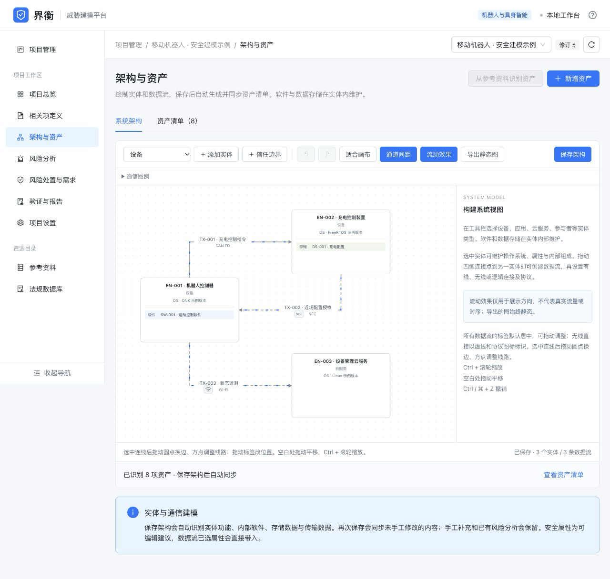
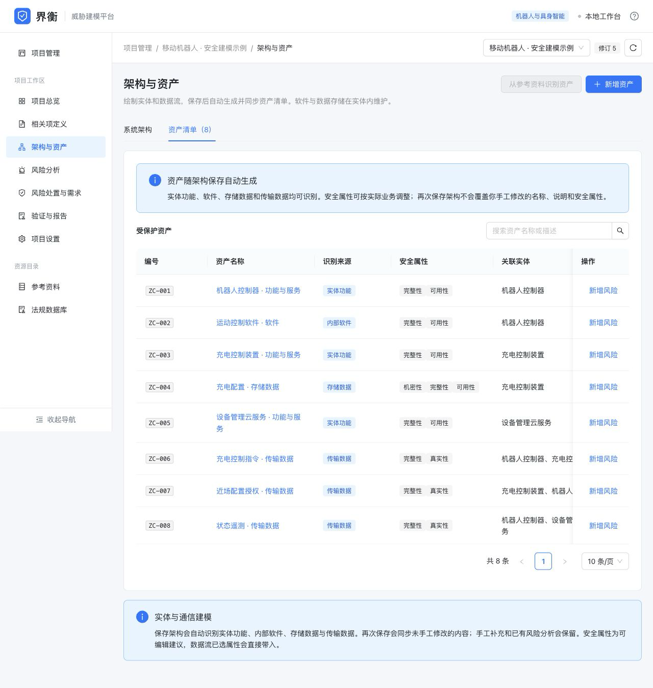
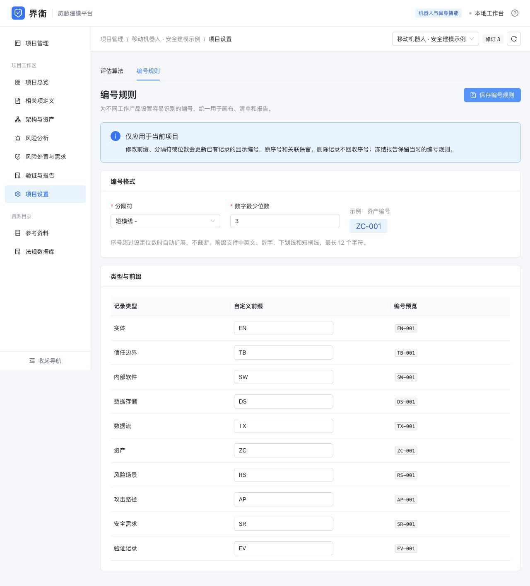
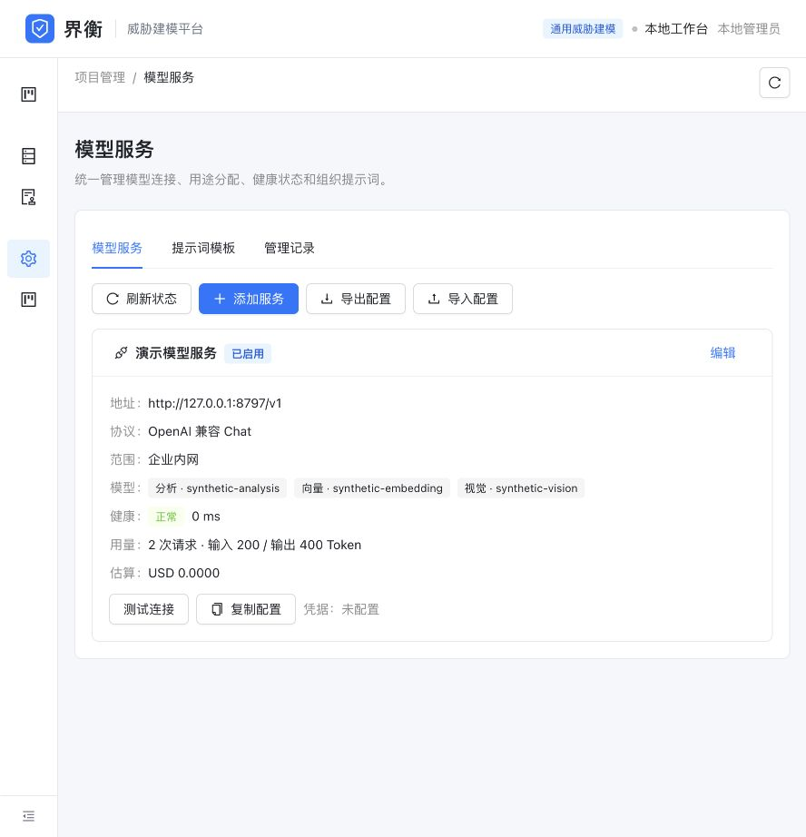
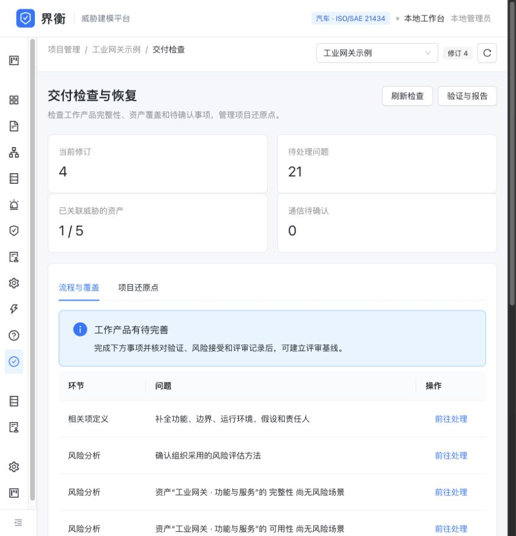
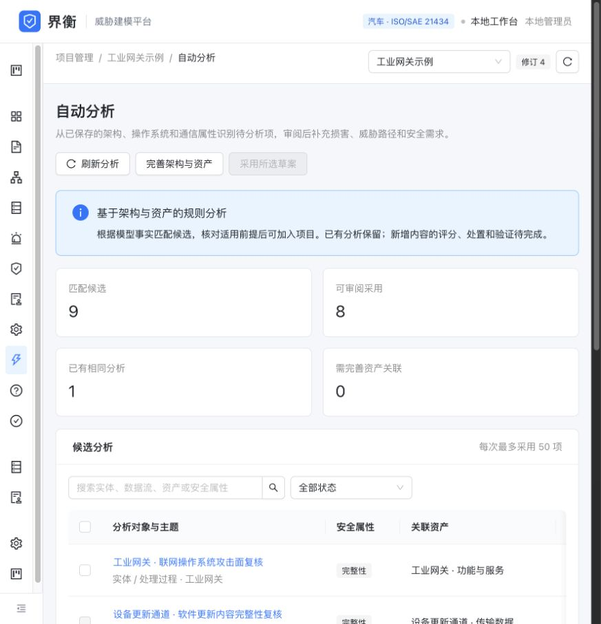
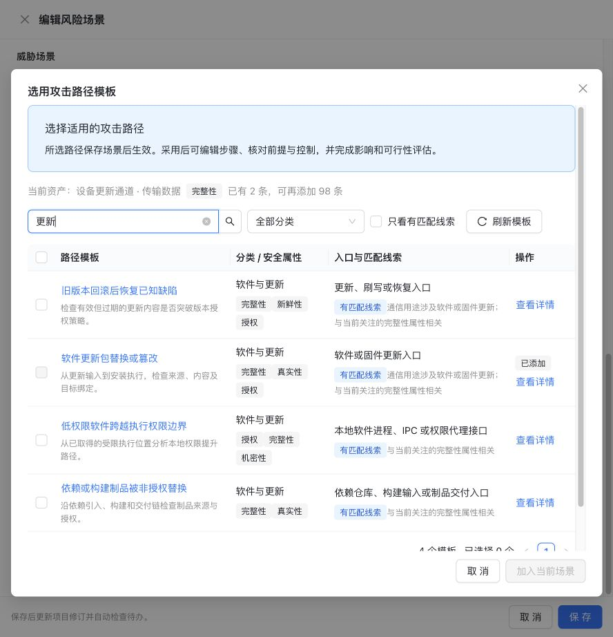

# 界衡 · 威胁建模平台

以 ISO/SAE 21434 的工作产品和追溯关系为基础，面向汽车、物联网、机器人及其他软硬件产品的本地威胁建模工作台。使用 **Go + SQLite** 后端、**React + Ant Design** 前端，支持从系统架构、资产和威胁分析，到风险处置、需求验证和静态报告的完整流程。

## 主要能力

| 环节 | 能力 |
| --- | --- |
| 相关项与 DFD | 实体模式或展开 DFD；信任边界、内部软件/存储、操作系统、数据流与电能流；有线/无线协议标注 |
| 布线与图形 | 拖动端点换边、调整线段和标签、网格整理；无线用虚线关联，不增加伪实体；流动效果仅用于画布，导出保持静态 |
| 资产识别 | 保存架构时同步生成资产、保留人工修改和风险关联；导入项目支持维护已有资产目录 |
| TARA 工作产品 | 独立损害场景、安全目标；多资产/多属性威胁关联、攻击路径、CAL、需求及接受条件 |
| 风险方法 | SFOP 最大值、权重或系数法；直接用系数总分计算风险，或先分级再查矩阵；支持五因子攻击潜力 |
| 处置与验证 | 区分残余风险目标和已验证结果；目标、需求或评估依据变化后，旧证据和处置需重新复核 |
| 法规引用 | 本地条款目录、版本定位和勾选引用；公开仓库初始为空，由使用者接入资料 |
| 工作簿与报告 | 约定格式 XLSX 预览与原子导入、原文件保留；当前工作产品、来源快照和审计记录导出 |
| 企业模型 | 四种协议、用途模型、加密凭据、显式备用链、健康与用量、无密钥配置交换 |
| 辅助分析 | 图片转原生 DFD、全流程草案、质量复核；来源追溯、人工采用、可恢复 |
| 自动分析 | 8 条内置确定性规则、命中理由与前提、人工采用、去重和还原点，无需模型 |
| 攻击路径 | 16 类预置模板、按资产查看匹配线索、批量加入可编辑草稿；保留模板版本与项目路径编号 |
| 企业知识 | 8 个公开漏洞分析案例、版本化待复核导入、CISA KEV 增量收集工具；语义和关键词检索 |
| 内网交付 | 账号角色、项目成员、确定性交付检查、还原点与独立备份恢复 |
| 开发接口 | 版本化资源 API、OpenAPI、并发修订检查、幂等写入和统一错误格式 |

平台不替代工程判断或标准符合性评审；算法由项目确认，不能把某一套评分矩阵视为标准强制值。

## 界面预览

以下界面使用演示项目。

实体间统一布线，协议直接标在连线上；端点、线段和标签可手工调整。



保存架构后自动生成资产；已有目录可保留原编号和人工维护内容。



“项目设置 → 编号规则”支持按类型配置前缀、分隔符与数字位数，画布、清单和报告统一显示。



模型服务支持统一配置与连接检查；交付检查汇总工作产品完整性和待处理事项。图中的模型连接为演示测试服务。





不依赖模型的规则分析，审阅后加入待评估工作产品。



按资产条件筛选攻击路径模板，补充项目事实后继续评级；已添加模板会标记并避免重复。



## 从源码运行

准备 Go（版本见 `next/server/go.mod`）、Node.js 22.12 或更新的兼容版本，以及 npm。在仓库根目录执行：

```sh
./next/tools/build-go.sh
npm ci --prefix next/client
npm run build --prefix next/client
./start.sh
```

打开 http://127.0.0.1:8790 。默认数据文件为 `next/var/assurance.sqlite3`，服务只监听回环地址。需要独立端口或数据库时直接启动：

```sh
./next/bin/jieheng --root . --database next/var/demo.sqlite3 --port 8791
```

源码仓库不附运行数据库、项目报告、本机二进制或前端构建产物。法规目录初始为空，可直接进行建模与开发测试。按 [法规接入说明](next/data/regulations/README.md) 在本地接入有权使用的资料；应用不会自动联网获取正文。

## 企业内网与辅助分析

企业模式通过同机 HTTPS 反向代理提供登录及项目权限；本机模式仍可独立使用。接入企业模型后，可从图片生成原生 DFD，结合自有知识生成全流程分析草案，审阅采用后继续人工验证和报告交付。模型输出以草案形式采用，验证与签署需在相应流程中独立记录。详见 [企业部署](next/ENTERPRISE_DEPLOYMENT.md) 和 [模型服务与辅助分析](next/AI_ASSISTANCE.md)。

## TARA 导入与导出

创建空白项目，在“TARA 工作产品”中选择 XLSX，检查预览后导入。导入会核对编号、引用关系和原始评分；失败时整体回滚，不覆盖已有工作产品。损害场景、目标、需求和处置成为可编辑记录，同时保留完整来源表页及字节一致的原文件。

当前提供 `tara-chinese-v1` 约定版式适配器，**不支持任意 Excel 自动识别**。表头、编号、计算方法和大小限制见 [TARA 工作簿接入](next/TARA_IMPORT.md)。导入后的残余风险仍是设计目标，确认和签署状态按实际记录展示。

标准 XLSX 导出包含 17 张基础工作表；使用扩展 TARA 工作产品时增加 6 张追溯表，导入项目再追加全部来源表页快照。采用 AI 时按需增加辅助分析追溯及待确认建议表；采用确定性规则时增加自动化分析追溯表。当前资产元数据和编辑结果进入工作产品表，原表快照保持不变。报告图形为静态；来源公式作为文本保留，不执行。见 [Excel 导出格式](next/EXCEL_EXPORT.md)。

## 开发与验证

```sh
(cd next/server && go test -race ./... && go vet ./...)
node --test next/tests/*.mjs next/tests/*.cjs
python3 next/tools/test_public_release.py
```

前端布线测试读取构建产物，请先完成前端构建。Go 测试使用临时数据库和独立构造的工作簿、法规数据。GitHub Actions 执行后端、前端和公开源码范围检查。

- [工作流设计参考](next/PRODUCT_RESEARCH.md)
- [攻击路径模板](next/ATTACK_PATH_TEMPLATES.md)
- [确定性自动分析](next/AUTOMATION.md) · [公开知识积累](next/PUBLIC_KNOWLEDGE.md)
- [功能和开发说明](next/README.md)
- [领域与模块](next/ARCHITECTURE.md)
- [版本化 API](next/API_CONVENTIONS.md) · [OpenAPI](next/server/openapi.json)
- [扩展流程、算法和报告](next/EXTENDING.md)
- [后端运行与数据兼容](next/GO_MIGRATION.md)

## 部署范围与扩展

当前版本支持单企业、单实例内网部署和本机工作台。尚未提供 SSO/MFA、合格电子签名、审批流、分布式高可用或大规模向量服务。集成测试使用固定响应服务验证协议和流程；实际识图与分析质量取决于配置的模型，应使用部署环境中的代表性样例评估。跨行业流程、额外工作簿版式和专用报告可按扩展文档二次开发。接口服务不应直接作为公网多租户服务部署。

源码仓库包含应用代码、测试、公开案例分析、演示截图和开发文档。运行数据库、项目资料和法规正文由部署方管理，不随源码分发。仓库目前未选定开源许可证；公开可见不表示已授予额外的使用、修改或再分发许可，第三方依赖遵循各自许可证。
